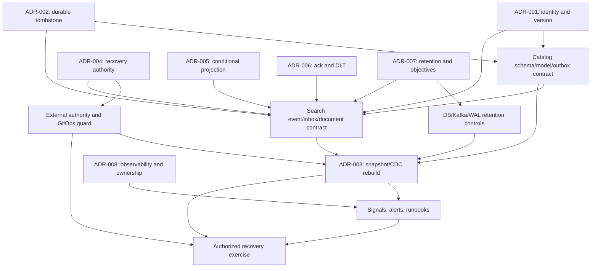

# Implementation Dependency Map

This is a proposed ordering after ADR approval, not authorization to implement.
Each arrow is a hard semantic dependency unless marked as parallel.

## Repository sequence

| Order | Repository | Prerequisite | Coordinated release boundary |
|---|---|---|---|
| 0 | All owners | Accept applicable ADRs, assign accountable/operational owners, approve acceptance criteria | No code change before explicit implementation authorization |
| 1A | product-catalog | ADR-001/002 and schema rollout policy | Expand schema/model, persist tombstones, emit compatible versioned events |
| 1B | platform-infrastructure | ADR-004/007 authority and retention selection | Provision selected protected record and observability/CDC prerequisites |
| 1C | platform-gitops | ADR-004 approved state machine and platform outputs | Add desired-state mirror/pre-sync guard; cannot independently advance authority |
| 2 | product-search | Compatible Catalog event contract plus ADR-005/006 | Inbox/projection fencing, listener/ack/DLT semantics, generation-isolated writes |
| 3 | platform-infrastructure + platform-gitops | Search implementation interfaces; ADR-003 approved protocol | Stable topic metadata, CDC continuity checks, authorized rebuild orchestration |
| 4 | platform-observability and source repos | ADR-008 named owner/backend/retention | Component metrics, shared dashboards/alerts, operational runbooks |
| 5 | All six | All previous phases; controlled environment approval | Failure-injection/recovery exercises, evidence review, production readiness gate |

Catalog event contract work and recovery-authority infrastructure can proceed
as independent design/implementation preparations after their ADRs are
accepted. Search must not rely on new fields until Catalog compatibility is
deployed. Rebuild orchestration cannot be accepted until snapshot export,
conditional projection writes, offset behavior, and authority fencing are
available. Observability instrumentation can proceed per owner, but a shared
backend must not be introduced without separate approval.

## Cross-repository release gates

1. Agree and test an expand/contract event schema rollout before changing the
   producer.
2. Deploy readers that understand the new identity/version/tombstone fields
   before emitting them.
3. Configure and verify the external recovery authority before enforcing
   epoch mismatch failures.
4. Establish strict projection version semantics before enabling replay or
   rebuild promotion.
5. Validate Kafka offset/ack/DLT behavior before claiming source progress.
6. Establish measured retention and restore procedures before cleanup.
7. Perform controlled end-to-end failure tests before enabling production
   recovery automation.
